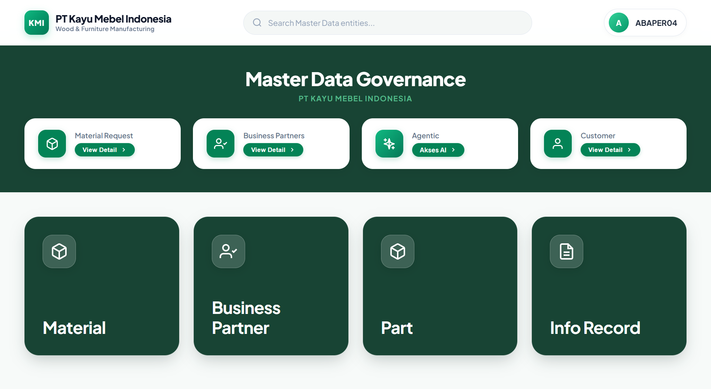

# SAP Master Data Governance (MDG) Staging Platform




Platform berbasis **SAP BSP (Business Server Pages)** untuk mengelola **SAP Master Data Governance (MDG)** yang mencakup pembuatan, pencarian, validasi, dan alur persetujuan bertingkat (*multi-level approval workflow*) untuk **Material Master (MDG-M)**, **Business Partner (MDG-BP)**, **Purchasing Info Record**, serta **Furniture BOM & Part Staging (Penjualan / R&D)**.

---

## Fitur Utama

### 1. Material Master (MDG-M)
* **Search & Reference MARA:** Pencarian data acuan `MARA`, `MAKT`, `MARC`, `MBEW` dengan dukungan parameter wildcard dan *alpha conversion*.
* **BOM Staging Platform:** Penyiapan spesifikasi kayu/furniture dan *Bill of Materials* (BOM) multi-level secara dinamis.
* **Workflow Approval:** Alur pengajuan (*Request*), persetujuan (*Approval*), penolakan (*Reject*), serta pembaharuan (*Update*) oleh Data Steward.
* **Desain Modern:** Mengusung antarmuka *Emerald Glassmorphism* yang responsif dan interaktif.

### 2. Business Partner (MDG-BP)
* **Customer & Vendor Creation:** Form pengajuan pembuatan Customer dan Vendor baru lengkap dengan penanganan atribut dan *type definitions*.
* **Bank Steward & Data Steward Portal:** Pengelolaan data rekening bank (*Bank Steward*) serta validasi data induk perusahaan.
* **Kamus Data SE11:** Struktur tabel kustom `ZTB_BP_REQ` dan `ZTB_BP_DMS_DOC` untuk penampungan sementara (*staging table*) sebelum diajukan ke tabel standar SAP `BUT000`.

### 3. Penjualan & R&D Furniture BOM
* **Multi-Sheet Excel Ingestion:** Parser cerdas membaca lembar kerja `Bom Material` dan `Bom Hardware` secara otomatis.
* **Master Part & Component Staging:** Penataan data komponen kayu, part mentah (*rough size*), part jadi (*finish size*), serta *hardware* ke tabel staging `ZMDG_STG_HDR` dan `ZMDG_STG_PART`.
* **Modul Terintegrasi:** Mendukung integrasi langsung ke SAP melalui `BAPI_MATERIAL_SAVEDATA` dan `BAPI_ROUTING_CREATE`.

### 4. Purchasing Info Record (Finance / Purchasing)
* **PIR Staging & Creation:** Alur pengajuan dan validasi data Info Record pembelian (`EINA`/`EINE`).
* **Approval Portal:** Persetujuan data Info Record sebelum diposting ke database transaksi SAP.

### 5. Testing AI & OData Middleware
* **OData Gateway:** Penghubung AI middleware dengan layanan OData SAP S/4HANA.
* **Automated Assistant:** Ekstraksi spesifikasi teknis CAD/BOM berbasis kecerdasan buatan.

---

## Struktur Direktori

```text
MASTER DATA GOVERNANCE/
├── Approval/                   # Centralized Approval Portal
│   ├── bp_approval/            # Approval Business Partner
│   ├── ir_approval/            # Approval Info Record
│   └── mm_approval/            # Approval Material Master
│
├── BUSINESS PARTNER/           # Modul Staging & Handling Business Partner (MDG-BP)
│   ├── bp_create_customer/     # Form BSP & handler ABAP untuk Customer
│   ├── bp_create_vendor/       # Form BSP & handler ABAP untuk Vendor
│   ├── bp_banksteward/         # Modul validasi Rekening Bank
│   ├── bp_datasteward/         # Portal Data Steward Business Partner
│   └── *.xlsx                  # Kamus data & definisi struktur tabel SE11
│
├── DATABASE/                   # Template Excel untuk pengajuan Request
│   ├── REQUEST CREATE MATERIAL.xlsx
│   └── REQUEST CHANGE MATERIAL.xlsx
│
├── FINANCE/                    # Modul BSP Purchasing Info Record (Create Request)
│   ├── ir_create_request.htm
│   └── *.abap
│
├── INFO RECORD/                # Dataset & referensi Info Record
│   ├── Create info record/
│   └── data_info_record.xlsx
│
├── MATERIAL MASTER/            # Modul Staging & Approval Material Master (MDG-M)
│   ├── datasteward/            # Portal pengelolaan data oleh Data Steward
│   ├── Excel/                  # Template & sampel dataset Material Master
│   ├── HIST_APPROVED/          # Riwayat data yang disetujui
│   ├── HIST_REJECTED/          # Riwayat data yang ditolak
│   ├── landing/ & sidebar/     # Komponen navigasi dan landing page BSP
│   ├── Request Material/       # Form pengajuan pembuatan material
│   ├── Request_change/         # Form pengajuan perubahan material
│   └── UPDATE/                 # Versi iterasi pembaruan material
│
├── MODUL MDG/                  # Panduan teknis & pemetaan tabel SAP
│   ├── SAP tables mapping.pptx
│   ├── SAP-MDG-rule-based-workflow.pdf
│   └── Master Data Governance for Materials.pdf
│
├── PENJUALAN/                  # Modul Furniture BOM & R&D Part Staging
│   ├── AI BOM/                 # Alur otomatisasi BOM berbasis AI
│   ├── Approval/               # Halaman approval staging & program BAPI
│   ├── component_request/      # Form pengajuan komponen
│   ├── Excel/                  # Arsip sampel Excel BOM, Hardware, & Routing
│   ├── landing/                # Halaman muka modul Penjualan
│   ├── new_master_part/        # BSP siap pakai untuk SE80 (HTM & ABAP Handlers)
│   ├── PART (NOT USE)/         # Arsip berkas versi lama
│   ├── part_request/           # Form pengajuan part
│   └── sidebar_penjualan.htm   # Navigasi sidebar
│
└── Testing ai/                 # Ekosistem pengujian AI & OData
    ├── Odata/                  # Handler ABAP EntitySet OData
    ├── sap-ai-middleware/      # Node.js Express server middleware
    ├── test_ai.htm             # Antarmuka uji coba AI
    └── Odata.html              # Antarmuka pengujian gateway OData
```

---

## Ketentuan Teknis & Arsitektur (SAP SE80)

Proyek ini dibangun mengikuti batasan ketat lingkungan **SAP BSP SE80 Runtime**:

1. **JavaScript Engine:** Wajib menggunakan **Vanilla ES5** (`var`, `function()`, tanpa sintaks ES6 seperti `let`, `const`, *template literals*, atau *arrow function*).
2. **Batas Panjang Baris:** Maksimal 255 karakter per baris pada file `.htm` dan JavaScript agar sesuai batas kompilasi SAP SE80 (direkomendasikan 80-120 karakter).
3. **Keamanan Escape String:** Hindari penulisan regex literal `/\\/g` pada JavaScript BSP; gunakan `split(String.fromCharCode(92)).join("/")`.
4. **Integrasi ABAP BSP:** Penggunaan tag `<% IF ... %>`, `<% DATA ... %>`, serta event handler `OnInitialization.abap` dan `OnInputProcessing.abap`.
5. **State Management DB Defensive:** Selalu melakukan pengecekan `sy-subrc` secara eksplisit setelah eksekusi query database sebelum melakukan manipulasi internal table.

---

## Pemetaan Tabel SAP (Mapping Reference)

| Modul | Nama Tabel SAP | Keterangan |
| :--- | :--- | :--- |
| **Material Master** | `MARA` | General Material Data |
| | `MAKT` | Material Descriptions |
| | `MARC` | Plant Data for Material |
| | `MBEW` | Material Valuation |
| **Business Partner** | `BUT000` | BP General Data (Header) |
| | `BUT020` | BP Addresses |
| | `LFA1` | Vendor Master (General Detail) |
| | `KNA1` | Customer Master (General Detail) |
| | `ZTB_BP_REQ` | Custom Staging Table for MDG Request |
| | `ZTB_BP_DMS_DOC` | Custom Staging Table for DMS Attachments |
| **Penjualan / R&D** | `ZMDG_STG_HDR` | Staging Header Material Part |
| | `ZMDG_STG_PART` | Staging Item Material Part |
| **Info Record** | `EINA` | Purchasing Info Record: General Data |
| | `EINE` | Purchasing Info Record: Purchasing Organization Data |

---

## Lisensi

Copyright © 2026 - Master Data Governance Staging Platform. All Rights Reserved.
