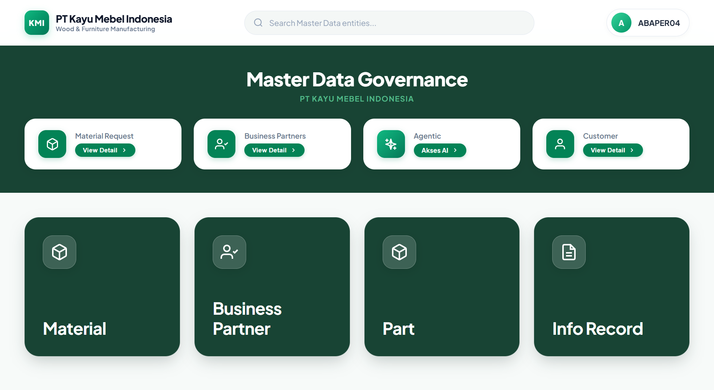

2024

### SAP Master Data Governance (MDG) Platform

Enterprise Staging Platform & Multi-Level Workflow Engine for PT Kayu Mebel Indonesia

Platform berbasis **SAP BSP (Business Server Pages)** untuk mengelola **SAP Master Data Governance (MDG)** yang mencakup pembuatan, pencarian, validasi, dan alur persetujuan bertingkat (*multi-level approval workflow*) untuk:
- **Material Master (MDG-M)** (MARA, MAKT, MARC, MBEW)
- **Business Partner (MDG-BP)** (Customer & Vendor KMI)
- **Purchasing Info Record** (EINA, EINE)
- **BOM Staging Platform** (Komponen Kayu, Furniture & Part Staging)

Year

#### 2024

Category

#### ENTERPRISE WEB PLATFORM / SAP MDG

Live Demo

[

#### Buka Demo MDG

](/project/MDG/landing_page.html)

