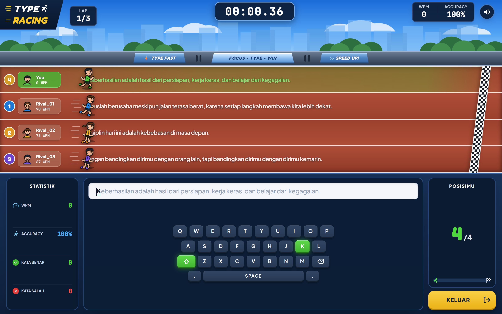

2025

### Type Racing Stadium Edition

Interactive Stadium Typing Sprint & Real-Time WPM Race Engine

Game balap ketik atletik di stadion (*stadium sprint typing race*) murni berbasis **HTML5 Canvas/DOM, CSS Animation, dan Web Audio API** tanpa engine pihak ketiga.

Fitur Utama:
- **Real-Time WPM & Accuracy Telemetry**: Pelacakan kecepatan mengetik kata per menit (WPM), akurasi persentase, kata benar, dan kata salah secara langsung.
- **Dynamic Sprinter Mechanics**: Karakter pelari dengan animasi anggota tubuh (*leg run*, *arm swing*, *body bob*, dan *speed lines*) yang bergerak maju seiring ketikan pengguna.
- **Multi-Lane AI Competitors**: Beradu cepat melawan 3 pelari AI dengan tingkatan kesulitan adaptif (*Mudah, Sedang, Pro*).
- **Interactive Virtual Keyboard**: Keyboard visual di layar dengan status tombol aktif (*key target green highlight*), penekanan tombol (*key-pressed*), dan peringatan salah (*key-wrong flash*).
- **Stadium Atmosphere & Soundscapes**: Efek visual langit dinamis, siluet kota, pepohonan, serta sintesis audio prosedural untuk ketikan, kesalahan, dan musik fanfare kemenangan.

Year

#### 2025

Category

#### INTERACTIVE GAME / WEB DEVELOPMENT

Live Demo

[

#### Mainkan Game Type Racing

](/project/type_racing_stadium_edition.html)

